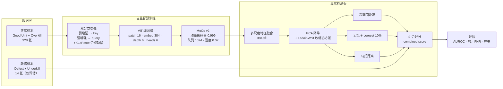

<div align="center">

# 半导体晶圆无监督缺陷检测

**ViT + MoCo v2 自监督预训练 · 只用正常样本训练的异常检测系统**


</div>

> 本科毕业设计。工业质检的真实困境是：**良品成千上万，缺陷屈指可数，而且形态不可穷举**。没有足够的异常样本可学，就只能把「正常」学到极致，剩下的都算异常。

---

## 🎯 问题定义

晶圆图（wafer map）的检测任务有三个硬约束：

1. **异常样本极少** —— 本数据集 942 张图里只有 14 张缺陷，占 1.5%；
2. **缺陷形态开放** —— 划痕、污染、边缘崩裂……训练集见过的类型不代表测试集会遇到什么；
3. **代价不对称** —— 漏检（FNR）意味着坏片流出，远比误检（FPR）严重。

所以采用**单类分类 / 无监督异常检测**范式：训练阶段完全不接触缺陷样本，只用正常样本学习特征分布；推理时用「离分布距离」作为异常分数。

### 数据组织

数据集按产线的四类判定组织，代码中做了如下映射（见 `data/wafer_dataset.py`）：

| 目录 | 含义 | 训练用途 |
| :--- | :--- | :--- |
| `Good Unit` | 良品 | ✅ 正常样本 |
| `Overkill` | 过杀（判为坏、实为良） | ✅ 正常样本 |
| `Defect` | 真实缺陷 | 🚫 仅评估 |
| `Underkill` | 漏杀（判为良、实为坏） | 🚫 仅评估 |

> 把 `Overkill` 归入正常、`Underkill` 归入缺陷，是因为模型要学的是**物理缺陷本身**，而不是产线判定的松紧。这个映射直接决定标签噪声水平，是整条流水线的第一个决策点。

---

## 🏗 系统架构



核心思想：**特征质量决定上限，评分方法决定能否逼近上限**。自监督预训练用 MoCo v2 拉高特征判别力，下游用「PCA 白化 + 马氏距离」这类免训练方法，避免在小样本上过拟合。

---

## 🧩 模块设计

| 模块 | 实现 | 参考来源 | 解决的问题 |
| :--- | :--- | :--- | :--- |
| **自监督主干** | ViT 从零实现（`PatchEmbedding` / `MultiHeadSelfAttention` / `TransformerBlock`） | ViT (2020) | 全局感受野，适配大尺寸晶圆图 |
| **对比学习** | MoCo v2：动量编码器 + 1024 队列 + InfoNCE | MoCo v2 (2020) | 负样本来自队列，小 batch 也能训稳 |
| **多尺度特征融合** | 拼接不同深度层特征 | 本项目 | 微小缺陷在深层特征中被淹没 |
| **半导体专用增强** | 旋转 ±5°、水平/垂直翻转、高斯模糊；**不用大角度旋转与强色彩抖动** | 本项目 | 保留晶圆图的物理语义与方向性 |
| **CutPaste 合成异常** | 面积占比 2%–15% 的 patch，支持**细长划痕模式**、随机颜色扰动 | CutPaste (CVPR 2021) | 无真实缺陷样本时制造伪异常 |
| **超球面约束** | 特征向可学习中心收缩，权重 0.1 | CFA (CVPR 2023) | 让正常特征更紧凑，距离度量更稳 |
| **协方差估计** | PCA + **Ledoit-Wolf** 收缩 | CFA (CVPR 2023) | 小样本下样本协方差奇异，必须收缩 |
| **特征生成-判别** | `FeatureGenerator` + `FeatureDiscriminator`，隐层 256 | SimpleNet (CVPR 2023) | 在特征空间合成异常并学判别边界 |
| **记忆库** | 贪心 coreset 选取 10% 特征作参考集 | PatchCore (2022) | 用真实正常样本修正核密度估计 |
| **评分融合** | 马氏距离 / 超球面 / 记忆库距离加权 | 本项目 | 单一度量在不同缺陷类型上各有短板 |

---

## 📊 实验结果

### 主结果（wafer 数据集）

| 配置 | AUROC | F1 | Accuracy | FNR | FPR | 训练耗时 |
| :--- | ---: | ---: | ---: | ---: | ---: | ---: |
| **Exp0 基线**（ViT + MoCo，无附加模块） | 0.6749 | 0.0952 | 0.9183 | 0.7857 | 0.0711 | 5650 s |
| **完整模型**（全模块启用） | **0.7719** | **0.1373** | 0.9055 | **0.5714** | 0.0873 | — |
| **Δ 提升** | **+0.0970** | +0.0421 | −0.0128 | **−0.2143** | +0.0162 | — |

### 基线混淆矩阵（n = 942）

| | 预测正常 | 预测缺陷 |
| :--- | ---: | ---: |
| **实际正常** | TN = 862 | FP = 66 |
| **实际缺陷** | FN = 11 | TP = 3 |

正常样本 928 张、缺陷样本 14 张。基线的 Accuracy 0.9183 看似不错，但这是**不平衡样本的假象**——F1 只有 0.0952，14 个缺陷漏了 11 个。

完整模型把 AUROC 从 0.675 拉到 0.772、FNR 从 78.6% 降到 57.1%，方向是对的，但**距离工业可用（AUROC > 0.95）仍有明显差距**，这是本项目现状，不修饰。

### 跨数据集验证（MVTec AD · bottle）

| 数据集 | AUROC | F1 | Accuracy | 说明 |
| :--- | ---: | ---: | ---: | :--- |
| MVTec AD / bottle | 0.5825 | 0.8630 | 0.7530 | 未做类别特定调参，AUROC 偏低，**结果待复核** |

> **数据来源说明**：Exp0 数据来自 `ablation_results/ablation_summary_comprehensive.json`；「完整模型」为 `checkpoints_v3` 的历史训练结果，尚未通过统一消融脚本重跑，故不参与逐模块归因。MVTec 结果同样来自历史记录。

---

## 🧪 消融实验设计

采用**累积式设计**：每组在前一组基础上只加一个模块，用于隔离单模块增益。

| 实验 | 增量模块 | 状态 |
| :--- | :--- | :--- |
| Exp0 | ViT + MoCo（纯基线） | ✅ 已完成 |
| Exp1 | + 多尺度特征融合 | ⏳ 待运行 |
| Exp2 | + CutPaste 合成异常增强 | ⏳ 待运行 |
| Exp3 | + 超球面约束损失（CFA） | ⏳ 待运行 |
| Exp4 | + 特征生成-判别框架（SimpleNet） | ⏳ 待运行 |
| Exp5 | + 记忆库辅助检测（PatchCore 风格）= 完整版 | ⏳ 待运行 |

一键运行全部实验并生成汇总报告：

```bash
python run_ablation.py
```

输出：`ablation_results/ablation_summary_report.txt` · `ablation_summary_comprehensive.json` · 各组独立指标曲线。

---

## 🚀 快速开始

### 环境配置

```bash
conda create -n graduate python=3.13 -y
conda activate graduate

# Intel Arc (XPU) 版本；CUDA 用户把 index-url 换成 cu121 即可
pip install torch torchvision torchaudio --index-url https://download.pytorch.org/whl/xpu
pip install scikit-learn matplotlib
```

设备优先级在 `utils/device.py` 中自动判定：**CUDA → Intel XPU → CPU**，启动时打印设备名与显存。

### 数据准备

```bash
# 下载 MVTec AD（用于跨数据集验证）
python download_mvtec.py

# 晶圆数据按四类目录放到 ./data 下：
#   data/<产品>/Good Unit/*.png
#   data/<产品>/Overkill/*.png
#   data/<产品>/Defect/*.png
#   data/<产品>/Underkill/*.png
```

### 训练与评估

```bash
# 训练（晶圆数据集）
python -m wafer_defect_detection.train --dataset wafer --epochs 100

# 训练（MVTec AD 指定类别）
python -m wafer_defect_detection.train --dataset mvtec --mvtec_category bottle --epochs 100

# 仅评估
python -m wafer_defect_detection.train --mode eval --dataset wafer
```

### 常用参数

| 参数 | 默认 | 说明 |
| :--- | :--- | :--- |
| `--img_size` | 224 | 输入分辨率 |
| `--embed_dim` | 384 | ViT 嵌入维度（ViT-S 规模） |
| `--queue_size` | 1024 | MoCo 队列长度 |
| `--momentum` | 0.999 | 动量编码器更新系数 |
| `--temperature` | 0.07 | InfoNCE 温度 |
| `--epochs` / `--batch_size` / `--lr` | 200 / 32 / 1e-3 | 训练超参（AdamW） |
| `--cutpaste_prob` | 0.3 | CutPaste 触发概率 |
| `--hypersphere_weight` | 0.1 | 超球面损失权重 |
| `--generator_weight` / `--discriminator_weight` | 0.05 / 0.05 | SimpleNet 双头损失权重 |

模块开关：`--use_multiscale` `--use_cutpaste` `--use_feature_generator` `--use_hypersphere`（`store_true`，默认开启）。

---

## 📁 项目结构

```
under_graduate/
├── wafer_defect_detection/          # 核心模块包
│   ├── models/
│   │   ├── vit_encoder.py           # ViT 编码器（从零实现 + 预训练权重加载）
│   │   └── moco.py                  # MoCo v2 + 特征生成器/判别器 + 超球面中心
│   ├── detectors/
│   │   └── anomaly_detector.py      # PCA + Ledoit-Wolf + 超球面 + 记忆库 + 评分融合
│   ├── data/
│   │   ├── wafer_dataset.py         # 晶圆四类目录解析与标签映射
│   │   └── mvtec_dataset.py         # MVTec AD 适配
│   ├── utils/
│   │   ├── device.py                # CUDA / XPU / CPU 自动选择
│   │   └── transforms.py            # 半导体专用增强 + CutPaste
│   └── train.py                     # 训练 / 评估入口
├── baseline/                        # 基线对比实现
├── ablation_results/                # 消融汇总（json + txt + 各组目录）
├── run_ablation.py                  # 六组实验批量执行
├── download_mvtec.py                # MVTec AD 下载
└── run.sh / run.bat                 # 一键启动
```

---

## ⚠️ 已知限制与下一步

诚实记录当前状态，比粉饰指标有用：

1. **AUROC 仍不足**（0.772 < 0.95 的工业线）。瓶颈主要在特征：ViT 只有 6 层且从零预训练，928 张正常样本远不足以喂饱 Transformer。**最直接的改进是换 DINOv2 等强预训练主干**，冻结后直接做 PatchCore 式最近邻检索。
2. **缺陷样本仅 14 张**，任何依赖阈值的指标（F1 / FNR / FPR）方差极大——换一个阈值 F1 就能翻倍。所以现阶段以 **AUROC 为主要指标**，F1 仅作参考。
3. **消融实验只跑完基线**，逐模块归因尚未完成，不能断言哪个模块贡献最大。
4. **MVTec 结果异常**（AUROC 0.58 但 F1 0.86），说明评分与阈值跨数据集迁移有问题，需单独排查。
5. 下一步：跑完 Exp1–Exp5 → 引入预训练主干 → 加入像素级定位（缺陷热力图），从「有没有缺陷」推进到「缺陷在哪」。

---

## 📚 参考工作

- **ViT** — *An Image is Worth 16x16 Words*, Dosovitskiy et al., ICLR 2021
- **MoCo v2** — *Improved Baselines with Momentum Contrastive Learning*, Chen et al., 2020
- **CutPaste** — *Self-Supervised Learning for Anomaly Detection and Localization*, Li et al., CVPR 2021
- **CFA** — *Coupled Hypersphere Learning for Few-Shot Anomaly Detection*, CVPR 2023
- **SimpleNet** — *A Simple Network for Image Anomaly Detection and Localization*, Liu & Wang, CVPR 2023
- **PatchCore** — *Towards Total Recall in Industrial Anomaly Detection*, Roth et al., CVPR 2022
