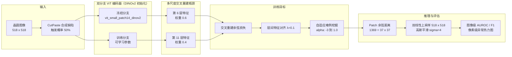

<div align="center">

# 半导体晶圆无监督缺陷检测

**ViT + ReContrast 双分支交叉重建 · DINOv2 自监督预训练 · 只用正常样本训练**


</div>

> 本科毕业设计。工业质检的真实困境是：**良品成千上万，缺陷屈指可数，而且形态不可穷举**。没有足够的异常样本可学，就只能把「正常」学到极致，剩下的都算异常。

---

## 🎯 问题定义

晶圆光学检测有三个硬约束：

1. **异常样本极少** —— 训练阶段只能拿到良品图，缺陷图仅用于评估；
2. **缺陷形态开放** —— 划痕、污染、焊盘缺失、纹理噪声……见过的类型不代表会遇到什么；
3. **代价不对称** —— 漏检（FNR）意味着坏片流出，远比误检（FPR）严重。

因此采用**单类分类 / 无监督异常检测**范式：模型只学正常样本的特征分布，推理时把「偏离分布的 Patch」作为异常证据。

### 数据组织

产线对晶圆有四种判定，代码中的标签映射如下（见 `wafer_defect_detection/data/wafer_dataset.py`）：

| 目录 | 含义 | 训练用途 |
| :--- | :--- | :--- |
| `Good Unit` | 良品 | ✅ 正常样本 |
| `Overkill` | 过杀（判为坏、实为良） | ✅ 正常样本 |
| `Defect` | 真实缺陷 | 🚫 仅评估 |
| `Underkill` | 漏杀（判为良、实为坏） | 🚫 仅评估 |

> 把 `Overkill` 归入正常、`Underkill` 归入缺陷，是因为模型要学的是**物理缺陷本身**，而不是产线判定的松紧。这个映射直接决定标签噪声水平，是整条流水线的第一个决策点。

---

## 🏗 方法架构

本方法以 **ReContrast 对比重构框架**为骨架，把骨干网络从 WideResNet-50 换成 **DINOv2-ViT**，并针对 ViT 无 BN 层的特性重做训练机制。



核心思路：**冻结分支提供干净的「正常特征基准」，训练分支学习如何重建它**。缺陷区域无法被准确重建，余弦距离自然放大——不需要见过任何缺陷样本。

---

## 🧩 关键设计

| 模块 | 具体做法 | 解决的问题 | 参考来源 |
| :--- | :--- | :--- | :--- |
| **DINOv2 双分支编码器** | 骨干由 WideResNet-50 换成 `vit_small_patch14_dinov2.lvd142m`，冻结分支 + 训练分支并置，瓶颈网络与解码器按 Patch Token 格式重写 | 微小缺陷特征被正常区域「淹没」，从零训练的特征判别力不足 | DINOv2 (TMLR 2024) |
| **CutPaste + 双输入训练** | 50% 概率对正常图施加图像空间合成缺陷，两分支各拿一路输入 | **ViT 没有 BN 层**，两分支同输入时瓶颈网络会退化成恒等映射，检测能力直接失效 | CutPaste (CVPR 2021) |
| **多尺度交叉重建瓶颈** | 第 6 / 11 层分别做交叉重建，层权重 0.6 / 0.4，层间特征对齐损失 λ = 0.1 | 中层纹理信息与深层语义信息互补，单一层无法覆盖不同尺度的缺陷 | ReContrast (2023) |
| **自适应难例挖掘** | α 三段式线性调度（−3 → 1.0），动态控制参与梯度计算的 Token 比例 | 全局等权聚合会让少数几个异常 Patch 的梯度被上千个正常 Patch 稀释 | 本文 |
| **异常评分与热力图** | Patch 级余弦距离 → 37×37 网格 → 双线性上采样至 518×518 → 高斯平滑（σ=4） | 从「有没有缺陷」推进到「缺陷在哪」，支撑产线定位需求 | 本文 |

> 第三点值得单独说明：这不是「加个 trick 提点分」，而是**换骨干后必须同步解决的架构性问题**。ViT 无 BN 导致两分支输出分布一致，交叉重建的监督信号消失——先定位到这个失败模式，再引入双输入机制，是本文的核心发现之一。

---

## 📊 实验结果

> 以下数值取自学位论文第 4 章。各小节使用不同的数据集与配置，**数值之间不可直接横比**，请按小节口径理解。

### 1. 消融实验

在 3 个晶圆品类上，以完整模型为基线（Exp0），逐一移除或替换单一模块：

| 实验 | 配置 | AUROC | Accuracy | F1 | ΔAUROC |
| :--- | :--- | ---: | ---: | ---: | ---: |
| **Exp0** | **Baseline（全模块开启）** | **0.9455** | **0.9776** | **0.9198** | — |
| Exp1 | 自重建替代交叉重建 | 0.9167 | 0.8712 | 0.9125 | −0.0288 |
| Exp2 | 无难例挖掘（等权聚合） | 0.8854 | 0.8552 | 0.9024 | −0.0601 |
| Exp3 | 随机初始化（无 DINOv2 预训练） | 0.5741 | 0.7555 | 0.8540 | **−0.3714** |
| Exp4-1 | n = 2 层多尺度特征 | 0.9274 | 0.9103 | 0.9407 | −0.0181 |
| Exp4-2 | n = 4 层（= 基线） | 0.9455 | 0.9776 | 0.9198 | — |
| Exp4-3 | n = 6 层多尺度特征 | 0.9425 | 0.9569 | 0.9162 | −0.0030 |

**从表中能读出的三件事**：

- **DINOv2 预训练是绝对主力**。换成随机初始化后 AUROC 掉到 0.5741（−0.37），几乎退化为随机猜测。这说明在小样本工业场景里，**预训练特征的质量决定上限**，后续模块只是逼近这个上限。
- **交叉重建与难例挖掘各自贡献 0.03–0.06**。单看不如预训练显眼，但两者都是 0 成本（推理时不增加参数量），属于纯赚。
- **层数不必贪多**。2 层已有 0.9274，4 层最优，6 层反而略降——过多层引入冗余信息，且计算开销线性增长。最终选 4 层是精度与效率的折中。

### 2. 与主流方法对比（自建晶圆数据集 · 3 品类）

| 方法 | AUROC | F1 | 说明 |
| :--- | ---: | ---: | :--- |
| ViT + MoCo v2 | 0.515 | 0.828 | 动量对比路线，**接近随机猜测** |
| PaDiM | 0.891 | 0.912 | Patch 特征分布建模（引用原文结果） |
| PatchCore | 0.919 | 0.943 | 核心集记忆库（引用原文结果） |
| **ViT + ReContrast（本文）** | **0.918** | **0.954** | AUROC 与 PatchCore 持平，F1 领先 1.1 个点 |

> MoCo 的表现是个反例教材：**对比学习的目标是「同图不同增强要像」，而这个任务要的是「正常与异常的细微差别」**。目标函数不对齐，特征再干净也用不上。这也是我从 v1 的 MoCo 路线转向交叉重构的直接原因。

### 3. 开源基准验证（MVTec AD）

| 品类 | AUROC | F1 | Accuracy |
| :--- | ---: | ---: | ---: |
| bottle | 1.0000 | 1.0000 | 1.0000 |
| capsule | 0.9645 | 0.9730 | 0.9545 |
| carpet | 0.9988 | 0.9944 | 0.9915 |
| **3 品类平均** | **0.9878** | **0.9891** | **0.9820** |

在公开基准上平均 AUROC 0.9878，与 PatchCore 的 0.989 基本持平，显著高于 PaDiM 的 0.891。这张表的意义是**排除了「只在自己数据集上调好」的怀疑**——同一套超参直接搬到 MVTec AD 就能用。

---

## ⚙️ 训练配置

| 项目 | 设置 |
| :--- | :--- |
| 硬件 | NVIDIA GeForce RTX 4070（12 GB） |
| 框架 | PyTorch |
| 优化器 | AdamW（β = [0.9, 0.999]） |
| 学习率 | 解码器 / 瓶颈网络 2×10⁻³；编码器 1×10⁻⁵ |
| 权重衰减 | 1×10⁻⁵ |
| Batch Size | 4（518×518 输入下的显存上限） |
| 训练迭代 | 1000 |
| 输入分辨率 | 518×518（DINOv2 原生分辨率）；对比实验用 224×224 |
| 损失函数 | 交叉重建余弦距离损失（正反两组重建任务） |
| 难例阈值 α | 动态调度，−3 线性增长至 1.0 |
| 结果口径 | 每个实验重复 3 次取均值 |

> Batch Size 只能给到 4 是个实打实的约束：ViT 的全局自注意力显存随 Patch 数平方增长，518² 输入下 1369 个 Token，12 GB 卡基本到顶。ReContrast 的队列式负样本设计恰好绕开了小 batch 的问题——这也是选它而不是 SimCLR 类方法的原因。

---

## 📦 数据集

### MVTec AD（公开基准）

15 个工业品类、5,354 张高分辨率图像，涵盖纹理类（carpet / grid / leather / tile / wood）与物体类（bottle / cable / capsule / hazelnut / metal nut / pill / screw / toothbrush / transistor / zipper）。训练集只含正常样本，测试集提供像素级缺陷掩码。

### 自建晶圆数据集

8 个真实产品品类，均为产线实拍、UP / DOWN 双光路：

| BGA 12×4 | BGA S5E 16×7 | ESSD 12×4 | ESSD 12×5 |
| :---: | :---: | :---: | :---: |
| INAND 19×5 | MicroSD 20×4 | SDSIP 22×3 | UBGA 12×5 |

**测试集扩充**：产线良品与缺陷样本数量严重失衡（如 BGA S5E 16×7 良品 52 张、缺陷仅 9 张），直接算 AUROC / F1 会有统计偏差。为此设计了一套合成缺陷扩增流程，把缺陷样本补到 `target = max(n_good, n_defect)`：

| 缺陷类型 | 生成方式 | 模拟的真实缺陷 |
| :--- | :--- | :--- |
| 划痕 Scratch | 随机方向直线 / 轻微曲线，透明度 18%–38% | 机械划伤 |
| 污渍 Stain | 半透明椭圆斑块 + 高斯模糊，透明度 12%–28% | 液体污染、化学残留 |
| 斑点 Spot | 3–6 个 1–2 px 圆形颗粒 | 颗粒污染 |
| 缺失 Missing | 矩形半透明暗区，占图 3%–10% | 焊盘缺失、区域损坏 |
| 纹理噪声 | 10% 像素施加 ±30 随机扰动 | 工艺变异 |

每次随机组合 1–3 种，并按轻度 / 中度控制透明度与尺寸，避免合成样本过于规整而被模型「记住」。

---

## 🚀 快速开始

### 环境配置

```bash
conda create -n graduate python=3.13 -y
conda activate graduate

# Intel Arc (XPU) 版本；CUDA 用户把 index-url 换成 cu121 即可
pip install torch torchvision torchaudio --index-url https://download.pytorch.org/whl/xpu
pip install scikit-learn matplotlib
```

设备优先级在 `wafer_defect_detection/utils/device.py` 中自动判定：**CUDA → Intel XPU → CPU**，启动时打印设备名与显存。

### 数据准备

```bash
# 下载 MVTec AD
python download_mvtec.py

# 晶圆数据按四类目录放置：
#   data/<产品>/Good Unit/*.png
#   data/<产品>/Overkill/*.png
#   data/<产品>/Defect/*.png
#   data/<产品>/Underkill/*.png
```

### 训练与评估

```bash
# 晶圆数据集
python -m wafer_defect_detection.train --dataset wafer --epochs 100

# MVTec AD 指定类别
python -m wafer_defect_detection.train --dataset mvtec --mvtec_category bottle --epochs 100

# 仅评估
python -m wafer_defect_detection.train --mode eval --dataset wafer
```

### 常用参数

| 参数 | 默认 | 说明 |
| :--- | :--- | :--- |
| `--img_size` | 224 | 输入分辨率（论文最终配置为 518） |
| `--embed_dim` | 384 | ViT 嵌入维度（ViT-S 规模） |
| `--queue_size` | 1024 | 对比学习队列长度 |
| `--momentum` | 0.999 | 动量编码器更新系数 |
| `--temperature` | 0.07 | InfoNCE 温度 |
| `--epochs` / `--batch_size` / `--lr` | 200 / 32 / 1e-3 | 训练超参 |
| `--cutpaste_prob` | 0.3 | CutPaste 触发概率 |

---

## 📁 项目结构

```
under_graduate/
├── wafer_defect_detection/          # 核心模块包（v1 · ViT + MoCo 路线）
│   ├── models/
│   │   ├── vit_encoder.py           # ViT 编码器（从零实现 + 预训练权重加载）
│   │   └── moco.py                  # MoCo v2 + 特征生成器/判别器
│   ├── detectors/
│   │   └── anomaly_detector.py      # PCA + Ledoit-Wolf + 马氏距离 + 记忆库
│   ├── data/
│   │   ├── wafer_dataset.py         # 晶圆四类目录解析与标签映射
│   │   └── mvtec_dataset.py         # MVTec AD 适配
│   ├── utils/
│   │   ├── device.py                # CUDA / XPU / CPU 自动选择
│   │   └── transforms.py            # 半导体专用增强 + CutPaste
│   └── train.py                     # 训练 / 评估入口
├── baseline/                        # 基线对比实现
├── ablation_results/                # v1 消融记录（json + txt + 各组目录）
├── run_ablation.py                  # 批量执行实验
├── download_mvtec.py                # MVTec AD 下载
└── run.sh / run.bat                 # 一键启动
```

---

## 📌 仓库现状说明

这个仓库记录的是**项目的第一阶段（v1）**，代码对应论文对比实验中的 `ViT + MoCo v2` 基线路线：

| 版本 | 技术路线 | 仓库状态 | 指标 |
| :--- | :--- | :--- | :--- |
| **v1** | ViT 从零训练 + MoCo v2 + PCA / 马氏距离评分 | ✅ 代码完整可跑，含 6 组累积消融脚本 | 晶圆全集 AUROC 0.6749 → 0.7719 |
| **v2** | DINOv2 双分支交叉重建 + CutPaste + 多尺度 + 难例挖掘 | 论文最终方案，方法见论文第 3 章 | 晶圆 3 品类 0.918 / MVTec 3 品类 0.9878 |

v1 的实测结论很有价值：**自监督对比学习在 928 张正常样本上根本喂不饱 6 层 ViT**，AUROC 卡在 0.77，换评分方法也救不回来。正是这个天花板促使 v2 转向预训练主干 + 交叉重建。`ablation_results/` 里的记录保留了这条弯路。

---

## ⚠️ 局限与后续方向

**方法本身的局限（论文 5.2 节）**

1. **推理速度**。ViT 全局自注意力的复杂度随 Patch 数平方增长，518×518 下单次前向开销较大，尚难满足高速产线节拍。可行方向：剪枝、知识蒸馏、注意力加速。
2. **跨品类泛化**。当前每个品类单独训练一个模型，换型号要重训。产线快速切换场景需要元学习或领域自适应。
3. **超参敏感**。难例阈值 α 的调度曲线、多尺度层权重对结果影响明显，且不同品类最优配置不一致。
4. **极小缺陷**。面积占比小于 0.1% 的缺陷检出率不稳定，仍是瓶颈。
5. **仅二维**。当前输入是平面投影图，无法检测凹陷深度、膜层厚度这类垂直方向异常。

**工程侧的欠账**

- 像素级定位只做了热力图可视化，尚未给出 PRO / IoU 等定位指标；
- 推理吞吐量未在生产环境下验证，实验室数字不能直接换算成产线 UP 值；
- 模型只有一个分辨率档位，缺少多尺度级联的加速方案。

---

## 📚 参考工作

- **ReContrast** — *Unsupervised Anomaly Detection via Contrastive Reconstruction*, 2023
- **DINOv2** — *Learning Robust Visual Features without Supervision*, TMLR 2024
- **ViT** — *An Image is Worth 16x16 Words*, Dosovitskiy et al., ICLR 2021
- **CutPaste** — *Self-Supervised Learning for Anomaly Detection and Localization*, Li et al., CVPR 2021
- **PatchCore** — *Towards Total Recall in Industrial Anomaly Detection*, Roth et al., CVPR 2022
- **PaDiM** — *A Patch Distribution Modeling Framework for Anomaly Detection*, Defard et al., ICPR 2021
- **MoCo v2** — *Improved Baselines with Momentum Contrastive Learning*, Chen et al., 2020
- **CFA** — *Coupled-Hypersphere-Based Feature Adaptation for Target-Oriented Anomaly Localization*, IEEE Access 2022

---

<div align="center">
<sub>作者 <a href="https://github.com/MorDream">MorDream</a> · 华东理工大学 · 2026</sub>
</div>
